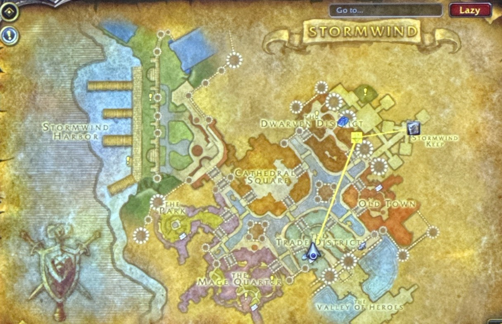

  

  
  
  
  

<h2 align="center">Stop alt-tabbing to guides. Press one button and go.</h2>

Forever Lazy is a levelling companion for WoW Forever that does the thinking for you. 
It knows your quests, your bags, your professions and the map, and it points an arrow at the next thing worth doing.

---

## A level 20 on a Tuesday night

You log in with a full quest log and no idea where to start. You click the minimap button.

- The arrow points at the **quest stop that earns the most XP for the walking**, with a note on what to do there.
- Your bags fill up, so the next click sends you to the **nearest vendor**.
- The next quest is two zones away, so it plans the **flight path, the boat and the hearthstone** for you.
- Your skill is stuck at 56, so it lights up **the exact recipe to craft** in your profession window and tells you how many.

No spreadsheets. No second monitor. No typing, unless you want to.

   
  <i>The recipe to craft next glows in your own profession window, with how many to make.</i>

   
  <i>Your route drawn on the world map, with a "Go to..." box and a Lazy button built in.</i>

## What you get

| | |
|---|---|
| **One-button Lazy Mode** | Click, and the arrow points at the best next thing: quest, vendor, trainer, or the next zone. |
| **A route that respects your time** | Your quest log planned for XP per minute, with stops numbered on the world map. |
| **Take me there** | Type a place and get a whole trip by flight, boat, tram and hearthstone. |
| **Crafting that tells you what to make** | The recipe to craft next glows in your recipe list with a count, using what is in your bags and bank, and says where to get the rest. |
| **Buttons where you already look** | A menu on the minimap, a search box on the world map, buttons on the quest log. Nothing to memorise. |
| **Duo mode** | Level with a friend who has the addon: shared plan, partner on your compass. |

And more: a journey to 60, class quests, dungeon levels, gathering and fishing routes, library books, a first-run tour.
See everything in the [feature guide](docs/FEATURES.md).

## It does not get in your way

- **Every part switches off.** Want only the arrow? One click.
- **Presets** set it up in seconds: Minimal, Leveler, Duo or Full.
- **Private.** It only talks to your own group or guild, and only the small details listed in [what it sends](docs/PRIVACY.md).
- **Free and open source**, MIT licensed.

## Install in a minute

1. Download the latest zip from [**Releases**](../../releases/latest).
2. Drop the **`ForeverLazy`** folder into `World of Warcraft\_forever_\Interface\AddOns\`.
3. Start the game. A welcome window walks you through it, and `/lazy` opens the options any time.

> **Get [Questie](https://www.curseforge.com/wow/addons/questie) too.** Forever Lazy uses its quest data to plan routes,
> find class quests and vendors, and work out where to get crafting materials.

## Early days, and I want your feedback

This is a young addon built by one player who levels with it. It works, and it is getting better fast, but some
corners have had little testing. If something looks wrong, type `/lazy check` and paste the result into an
[Issue](../../issues). Ideas and questions are welcome in [Discussions](../../discussions).

## Learn more

[Feature guide](docs/FEATURES.md) · [Commands](docs/COMMANDS.md) · [Teaching it a boat dock](docs/BOATS.md) · [Privacy](docs/PRIVACY.md) · [Changelog](CHANGELOG.md)

## Credits and licence

Built on HereBeDragons, AceComm, AceSerializer, CallbackHandler, LibDeflate and LibStub. Data from **Questie** and the
[wowforever.be](https://wowforever.be/guides/flight-paths/) flight path guide. The welcome photo of Sam Kinison is by
The World Famous Comedy Store, via Wikimedia Commons, [CC BY-SA 2.0](https://creativecommons.org/licenses/by-sa/2.0/)
(see `ForeverLazy/media/CREDITS.txt`). Not affiliated with RestedXP, Questie, Blizzard Entertainment or the WoW Forever team.

[MIT licence](LICENSE)
